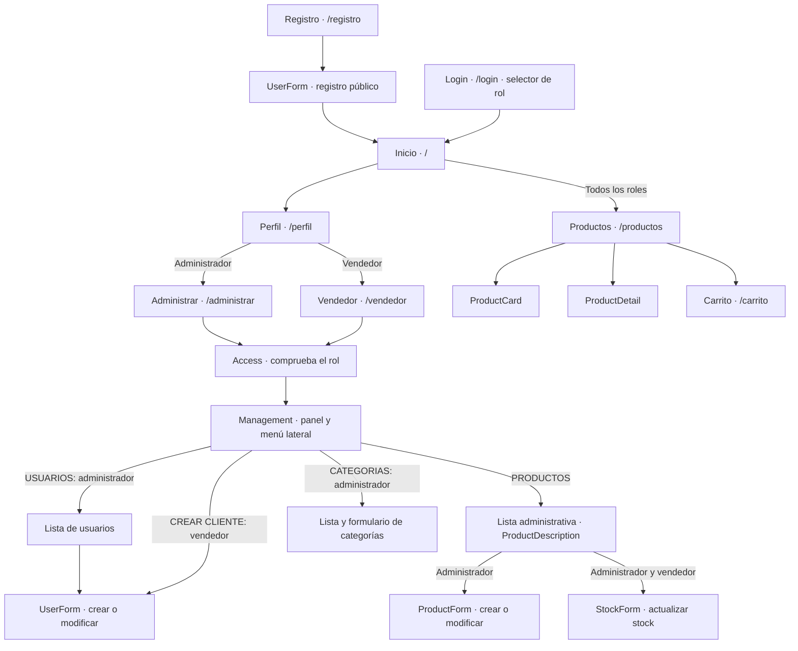

# React + TypeScript + Vite

This template provides a minimal setup to get React working in Vite with HMR and some ESLint rules.

Currently, two official plugins are available:

- [@vitejs/plugin-react](https://github.com/vitejs/vite-plugin-react/blob/main/packages/plugin-react) uses [Oxc](https://oxc.rs)
- [@vitejs/plugin-react-swc](https://github.com/vitejs/vite-plugin-react/blob/main/packages/plugin-react-swc) uses [SWC](https://swc.rs/)

## React Compiler

The React Compiler is not enabled on this template because of its impact on dev & build performances. To add it, see [this documentation](https://react.dev/learn/react-compiler/installation).

## Expanding the ESLint configuration

If you are developing a production application, we recommend updating the configuration to enable type-aware lint rules:

```js
export default defineConfig([
  globalIgnores(['dist']),
  {
    files: ['**/*.{ts,tsx}'],
    extends: [
      // Other configs...

      // Remove tseslint.configs.recommended and replace with this
      tseslint.configs.recommendedTypeChecked,
      // Alternatively, use this for stricter rules
      tseslint.configs.strictTypeChecked,
      // Optionally, add this for stylistic rules
      tseslint.configs.stylisticTypeChecked,

      // Other configs...
    ],
    languageOptions: {
      parserOptions: {
        project: ['./tsconfig.node.json', './tsconfig.app.json'],
        tsconfigRootDir: import.meta.dirname,
      },
      // other options...
    },
  },
])

```

You can also install [eslint-plugin-react-x](https://npmx.dev/package/eslint-plugin-react-x) and [eslint-plugin-react-dom](https://npmx.dev/package/eslint-plugin-react-dom) for React-specific lint rules:

```js
// eslint.config.js
import reactX from 'eslint-plugin-react-x'
import reactDom from 'eslint-plugin-react-dom'

export default defineConfig([
  globalIgnores(['dist']),
  {
    files: ['**/*.{ts,tsx}'],
    extends: [
      // Other configs...
      // Enable lint rules for React
      reactX.configs['recommended-typescript'],
      // Enable lint rules for React DOM
      reactDom.configs.recommended,
    ],
    languageOptions: {
      parserOptions: {
        project: ['./tsconfig.node.json', './tsconfig.app.json'],
        tsconfigRootDir: import.meta.dirname,
      },
      // other options...
    },
  },
])

```
<<<<<<< Updated upstream
=======

## Rutas

| Ruta             | Página                                   |
| ---------------- | ---------------------------------------- |
| `/`              | Inicio                                   |
| `/consultas`     | Servicios veterinarios                   |
| `/agendar`       | Formulario para agendar (`?consulta=...`) |
| `/productos`     | Catálogo con filtros, stock y detalle    |
| `/carrito`       | Carrito y pago                           |
| `/blog`          | Blog                                     |
| `/contactanos`   | Formulario de contacto y mapa            |
| `/quienes-somos` | Quiénes somos                            |
| `/login`         | Iniciar sesión                           |
| `/registro`      | Crear cuenta                             |
| `/perfil`        | Datos del usuario y cerrar sesión        |

Los datos (carrito, cuentas, sesión, stock y equipo) se guardan en
`localStorage` con las mismas claves que usaba el sitio anterior.


## Roles y administración

El registro público crea clientes. En esta etapa de demostración, cualquier cuenta registrada puede seleccionar ADMINISTRADOR, VENDEDOR o USUARIO al iniciar sesión; la selección se conserva durante la sesión y al recargar. USUARIO corresponde al rol Cliente.

- Administrador: Perfil → Administrar. Crear, consultar, modificar y eliminar usuarios, productos y categorías; asignar roles y desbloquear cuentas.
- Vendedor: Perfil → Administrar. Consultar todo el catálogo compartido, modificar solamente el stock y crear clientes. No hay asignación de productos a vendedores en el modelo actual.
- Cliente: navegación, carrito y funciones comerciales. Los tres roles pueden navegar y comprar.

Los formularios de usuarios comparten las validaciones del registro existente. Productos: nombre y distribuidora de al menos tres caracteres alfanuméricos, sin símbolos; precio entero CLP de al menos tres dígitos; stock entero no negativo. Categorías: mínimo tres letras, espacios permitidos, conversión a mayúsculas y sin duplicados. Eliminar una categoría conserva sus productos sin categoría. La distribuidora no se presenta en el catálogo comercial.

Los datos se guardan en localStorage del navegador. No hay backend: la selección libre de roles y las contraseñas locales son exclusivamente para demostración, no para producción. Un despliegue real requiere autenticación y autorización en servidor, contraseñas protegidas y roles asignados por un administrador, sin selección libre al ingresar.

Validación: `npm run build`, `npm run lint`, `npm run test:roles`. En entornos Windows restringidos que bloqueen la carga de configuración de Vite, se puede usar `node --experimental-strip-types node_modules/vite/bin/vite.js build --configLoader native` después de comprobar TypeScript.


## Mapa de navegación y componentes de roles



La navegación al perfil y la tienda se realiza mediante `Navbar`. Las secciones administrativas y sus formularios cambian dentro del panel, sin nuevas rutas.

| Componente | Archivo | Responsabilidad |
|---|---|---|
| `App` | `src/App.tsx` | Declara rutas, `Navbar` y `Footer`. |
| `AppProvider` | `src/context/AppProvider.tsx` | Estado, sesión, permisos de operaciones y persistencia. Envuelve `App` dentro de `BrowserRouter` en `main.tsx`. |
| `Login` | `src/pages/Login.tsx` | Credenciales y selección de rol para la sesión de demostración. |
| `Registro`, `UserForm` | `src/pages/Registro.tsx` | Registro público como cliente y formulario reutilizado para crear o modificar usuarios. |
| `Perfil` | `src/pages/Perfil.tsx` | Datos del usuario y acceso a Administrar según rol. |
| `Administrar`, `Vendedor` | `src/pages/Administrar.tsx` | Entradas de cada panel; renderizan `Access`. |
| `Access` | `src/pages/Administrar.tsx` | Redirige invitados al login, clientes al perfil y cada rol a su panel. |
| `Management` | `src/pages/Administrar.tsx` | Menú lateral, listas, formularios y confirmaciones de eliminación. |
| `ProductForm` | `src/pages/Administrar.tsx` | Alta y edición de productos para administrador. |
| `StockForm` | `src/pages/Administrar.tsx` | Actualización de stock para administrador y vendedor. |
| `ProductDescription` | `src/components/ProductCard.tsx` | Descripción compartida entre tienda y administración. |
| `Productos` | `src/pages/Productos.tsx` | Catálogo y filtros conectados a las categorías administradas. |

Las listas de usuarios, productos y categorías son secciones JSX de `Management`, no componentes independientes. El formulario de categorías también está dentro de `Management`. La tarjeta administrativa de productos reutiliza `ProductDescription`, no `ProductCard`. `AppContext` y `useApp` dan acceso al estado. `administracion.ts` y `registro.ts` contienen validaciones, no componentes visuales.
>>>>>>> Stashed changes
