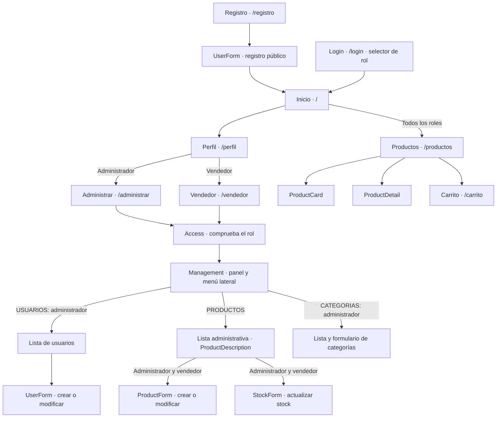

# Clínica NutriDifs (React)

Sitio de la clínica veterinaria migrado a **React + TypeScript + Vite**, con
rutas de **React Router**.

## Cómo ejecutarlo

Requiere Node.js 20 o superior.

```bash
npm install
npm run dev
```

Luego abre http://localhost:5173.

| Comando           | Qué hace                                   |
| ----------------- | ------------------------------------------ |
| `npm run dev`     | Servidor de desarrollo con recarga en vivo |
| `npm run build`   | Revisa tipos y genera la versión final en `dist/` |
| `npm run preview` | Sirve la versión de `dist/`                |
| `npm run lint`    | Revisa el código con ESLint                |

## Estructura

```
public/img/            Imágenes del sitio (se usan como /img/archivo.jpg)
src/
  main.tsx             Punto de entrada (router + estado global)
  App.tsx              Rutas y layout (menú, pie de página)
  components/          Navbar, Footer, ProductCard, ProductDetail, CampoError
  context/             Estado global: carrito, sesión, perfiles y catálogo
  data/                Productos, servicios, regiones/comunas y equipo
  hooks/usePage.ts     Título de la pestaña y clase del <body> por página
  pages/               Una página por ruta (Inicio, Productos, Carrito, ...)
  utils/               Validaciones, formato de moneda y localStorage
  styles/app.css       Estilos del sitio
version-anterior/      Sitio original en HTML/CSS/JS (solo como referencia)
```

## Rutas

| Ruta             | Página                                   |
| ---------------- | ---------------------------------------- |
| `/`              | Inicio                                   |
| `/consultas`     | Servicios veterinarios                   |
| `/agendar`       | Formulario para agendar (`?consulta=...`) |
| `/productos`     | Catálogo con filtros, stock y detalle    |
| `/carrito`       | Carrito y pago                           |
| `/blog`          | Blog                                     |
| `/contactanos`   | Formulario de contacto y mapa            |
| `/quienes-somos` | Quiénes somos                            |
| `/login`         | Iniciar sesión                           |
| `/registro`      | Crear cuenta                             |
| `/perfil`        | Datos del usuario y cerrar sesión        |

Los datos (carrito, cuentas, sesión, stock y equipo) se guardan en
`localStorage` con las mismas claves que usaba el sitio anterior.


## Roles y administración

El registro público crea clientes. En esta etapa de demostración, cualquier cuenta registrada puede seleccionar ADMINISTRADOR, VENDEDOR o USUARIO al iniciar sesión; la selección se conserva durante la sesión y al recargar. USUARIO corresponde al rol Cliente.

- Administrador: Perfil → Administrar. Crear, consultar, modificar y eliminar usuarios, productos y categorías; asignar roles y desbloquear cuentas.
- Vendedor: Perfil → Administrar. Consultar todo el catálogo compartido, agregar y modificar productos, y actualizar el stock. No puede crear clientes, eliminar productos ni gestionar categorías. No hay asignación de productos a vendedores en el modelo actual.
- Cliente: navegación, carrito y funciones comerciales. Los tres roles pueden navegar y comprar.

Los formularios de usuarios comparten las validaciones del registro existente. Productos: nombre y distribuidora de al menos tres caracteres alfanuméricos, sin símbolos; precio entero CLP de al menos tres dígitos; stock entero no negativo. Categorías: mínimo tres letras, espacios permitidos, conversión a mayúsculas y sin duplicados. Eliminar una categoría conserva sus productos sin categoría. La distribuidora no se presenta en el catálogo comercial.

Los datos se guardan en localStorage del navegador. No hay backend: la selección libre de roles y las contraseñas locales son exclusivamente para demostración, no para producción. Un despliegue real requiere autenticación y autorización en servidor, contraseñas protegidas y roles asignados por un administrador, sin selección libre al ingresar.

Validación: `npm run build`, `npm run lint`, `npm run test:roles`. En entornos Windows restringidos que bloqueen la carga de configuración de Vite, se puede usar `node --experimental-strip-types node_modules/vite/bin/vite.js build --configLoader native` después de comprobar TypeScript.


## Mapa de navegación y componentes de roles



La navegación al perfil y la tienda se realiza mediante `Navbar`. Las secciones administrativas y sus formularios cambian dentro del panel, sin nuevas rutas.

| Componente | Archivo | Responsabilidad |
|---|---|---|
| `App` | `src/App.tsx` | Declara rutas, `Navbar` y `Footer`. |
| `AppProvider` | `src/context/AppProvider.tsx` | Estado, sesión, permisos de operaciones y persistencia. Envuelve `App` dentro de `BrowserRouter` en `main.tsx`. |
| `Login` | `src/pages/Login.tsx` | Credenciales y selección de rol para la sesión de demostración. |
| `Registro`, `UserForm` | `src/pages/Registro.tsx` | Registro público como cliente y formulario reutilizado para crear o modificar usuarios. |
| `Perfil` | `src/pages/Perfil.tsx` | Datos del usuario y acceso a Administrar según rol. |
| `Administrar`, `Vendedor` | `src/pages/Administrar.tsx` | Entradas de cada panel; renderizan `Access`. |
| `Access` | `src/pages/Administrar.tsx` | Redirige invitados al login, clientes al perfil y cada rol a su panel. |
| `Management` | `src/pages/Administrar.tsx` | Menú lateral, listas, formularios y confirmaciones de eliminación. |
| `ProductForm` | `src/pages/Administrar.tsx` | Alta y edición de productos para administrador y vendedor. |
| `StockForm` | `src/pages/Administrar.tsx` | Actualización de stock para administrador y vendedor. |
| `ProductDescription` | `src/components/ProductCard.tsx` | Descripción compartida entre tienda y administración. |
| `Productos` | `src/pages/Productos.tsx` | Catálogo y filtros conectados a las categorías administradas. |

Las listas de usuarios, productos y categorías son secciones JSX de `Management`, no componentes independientes. El formulario de categorías también está dentro de `Management`. La tarjeta administrativa de productos reutiliza `ProductDescription`, no `ProductCard`. `AppContext` y `useApp` dan acceso al estado. `administracion.ts` y `registro.ts` contienen validaciones, no componentes visuales.

El perfil muestra Administrar y Cerrar sesión dentro de la tarjeta azul marino, en ese orden. El catálogo y la administración permiten buscar por nombre, sin distinguir mayúsculas ni tildes; en el catálogo la búsqueda se combina con categoría y precio.


## Medidas responsive

En `src/styles/app.css`, `.products-grid` conserva 4 columnas sobre 1100px, 3 hasta 1100px, 2 hasta 800px y 1 hasta 600px. Son productos por fila, no un límite de productos.

Los bloques finales de 600px y 360px ajustan registro y carrito para celulares, incluido 320px. Hasta 360px el carrito coloca la imagen encima de los datos. El botón de contacto no tiene márgenes laterales para evitar que su ancho del 100% sobresalga. Los contenedores y campos pueden encogerse sin recortar contenido.

Perfil/carrito mantienen su cambio de distribución a 820px. Administración conserva sus reglas en `src/styles/administrar.css` a 1000px y 700px.

El menú principal pasa a una segunda fila hasta 1000px para evitar desbordes en tablets intermedias (por ejemplo, 820px).
